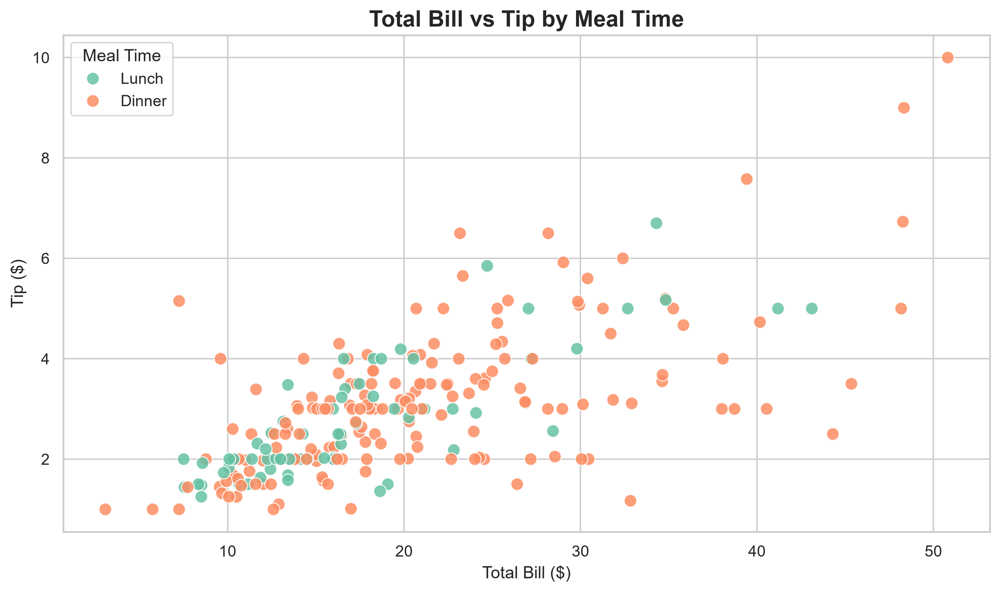

# Data Visualization with Matplotlib and Seaborn
# shout out to Roadmap.sh
data source: https://roadmap.sh/projects/data-visualization-tutorial
## Project Overview

This project explores Python's data visualization capabilities using Matplotlib and Seaborn. Using the built-in Seaborn Tips dataset, I recreated five common chart types in both libraries to practice plotting syntax, customization, and visual presentation.

The focus is on learning how the two libraries approach similar visualization tasks rather than conducting an extensive statistical analysis.

## Objectives

- Practice creating charts with Matplotlib and Seaborn.
- Compare the syntax and customization options of both libraries.
- Customize chart titles, axis labels, font sizes, colors, and palettes.
- Calculate and visualize correlations between numerical variables.
- Export a chart as a high-resolution PNG image.

## Technologies

- Python
- Pandas
- Matplotlib
- Seaborn
- Jupyter Notebook

## Dataset

The project uses the built-in Seaborn Tips dataset, loaded with `sns.load_dataset("tips")`.

The dataset contains 244 observations and seven columns, including total bill, tip, customer sex, smoking status, day, meal time, and party size.

The initial data-quality checks confirmed that all seven columns had no missing values.

## Visualizations

Five chart types were recreated using both Matplotlib and Seaborn:

1. **Histogram:** Distribution of restaurant bills.
2. **Bar Chart:** Average tip amount by day.
3. **Box Plot:** Distribution of total bills by day.
4. **Scatter Plot:** Relationship between total bill and tip, with meal time used to distinguish groups in Seaborn.
5. **Correlation Heatmap:** Correlations between numerical variables.

## Project Structure

```text
matplotlib-seaborn-data-visualization/
├── images/
│   └── tips_scatter_plot.png
├── notebooks/
│   └── tips_data_visualization.ipynb
├── README.md
└── requirements.txt
```

## Example Visualization



## Key Learning Outcomes

- Creating and customizing common chart types with Matplotlib.
- Using Seaborn's DataFrame-oriented plotting interface.
- Comparing direct plotting with higher-level statistical visualization.
- Grouping data and calculating averages with Pandas.
- Visualizing correlations using color scales and annotations.
- Saving publication-quality chart images.

## How to Run

1. Clone this repository.
2. Install the dependencies:

   ```bash
   pip install -r requirements.txt
   ```

3. Launch Jupyter Notebook or JupyterLab.
4. Open the notebook and run the cells.

## Conclusion

This project demonstrates practical experience with two widely used Python visualization libraries. Recreating the same charts in both libraries helped build familiarity with their syntax, customization features, and approaches to visualizing tabular data.
